 

 

 

[Case studies](https://mauriciotaguchi.com.br/case-studies/) · [Technical blog](https://mauriciotaguchi.com.br/blog/)

---

## About

I'm **Maurício Taguchi**, a data analyst and Computer Science graduate from UNIP in São Paulo, Brazil. I work with **SQL, Python, Power BI and Excel** to clean and validate data, automate recurring tasks and build dashboards. At FIPE, I prepared economic and collective bargaining data for researchers and managers.

My personal projects explore the engineering behind this work. In **Income Analysis in Brazil**, I use official IBGE data to compare income across states and quarters. In **DataFlow**, I built a tool for inspecting data quality and tracing or reversing changes to a dataset.

### Open To

I'm looking for **junior Data Analyst and Business Intelligence roles**, remote or based in São Paulo. I also offer freelance data analysis and automation services.

**Languages** · Portuguese (native) · English (advanced) · Spanish (basic)

---

## Featured Personal Projects

<strong>Brazil Income Analysis — Official IBGE Data Pipeline</strong>

 

A reproducible data engineering and analytics case study using official IBGE SIDRA income data.

| Dimension | Details |
| :--- | :--- |
| **Stack** | Python · Pandas · SQL · Pytest · Ruff · GitHub Actions · HTML/CSS |
| **Scale** | Coverage validation for all 27 Brazilian federative units over the 20 quarters from Q2 2021 to Q1 2026. |
| **Performance** | Bounded quarterly extraction and deterministic offline rebuilding from a committed source snapshot. |
| **Security** | Public source data, pinned dependencies and automated dependency-update monitoring. |
| **Impact** | Produces analytical datasets, a static dashboard and an executive summary with traceable source definitions. |
| **Explore** | [Case study](https://mauriciotaguchi.com.br/case-studies/brazil-income.html) · [Interactive dashboard](https://mauriciotaguchi.com.br/demos/income/) · [Source code](https://github.com/MauricioTaguchi/analise-renda-brasil) |

The pipeline separates **raw, staging and analytical layers**, validates coverage and invalid values, and preserves original responses for reprocessing. Official-series outputs are clearly distinguished from complementary synthetic portfolio examples. Tests enforce a configured **80% minimum coverage threshold**.

<strong>DataFlow — Data Analytics Platform</strong>

 

A full-stack analytics workspace that takes a dataset from ingestion to validated transformations, interactive dashboards and PDF reporting.

| Dimension | Details |
| :--- | :--- |
| **Stack** | Python · FastAPI · React · TypeScript · PostgreSQL · Redis · Celery · Docker |
| **Scale** | Bounded workloads with account quotas, upload admission controls and background job concurrency limits. |
| **Performance** | Asynchronous import, profiling, transformations and reports; cached coordination and paginated previews. |
| **Security** | Tenant isolation, rotating refresh tokens, revoked sessions, rate limits and streamed upload validation. |
| **Impact** | Connects data-quality inspection, reversible transformations, lineage and reporting in one reviewable product workflow. |
| **Explore** | [Case study](https://mauriciotaguchi.com.br/case-studies/dataflow.html) · [Interactive demo](https://mauriciotaguchi.com.br/demos/dataflow/) · [Source code](https://github.com/MauricioTaguchi/data-analytics-platform) |

The engineering centers on **recoverable data operations**: optimistic versions prevent conflicting changes, idempotency keys make retries explicit, and a transactional outbox preserves committed work during broker failures. Backend checks, frontend tests and desktop/mobile end-to-end journeys support the application. Deployment limits and operational responsibilities are documented.

<strong>MarketPulse — Market Data & Pipeline Observability</strong>

 

A near-real-time dashboard that ingests public Binance Spot data and presents market activity, pipeline health and experimental statistical forecasts.

| Dimension | Details |
| :--- | :--- |
| **Stack** | Java 17 · Spring Boot · React · TypeScript · PostgreSQL · Redis · WebSocket/STOMP · Docker |
| **Scale** | Single-instance MVP with per-symbol streams, bounded buffers and durable closed-candle storage. |
| **Performance** | Push-based interface updates, backend coalescing, hot-state caching and measured ingestion latency. |
| **Security** | Read-only public-data integration, configured frontend origins, WebSocket transport limits and restricted operational endpoints. |
| **Impact** | Makes source freshness, reconnections, throughput and forecast uncertainty visible alongside market data. |
| **Repository** | [Explore MarketPulse](https://github.com/MauricioTaguchi/marketpulse-live-dashboard) |

The pipeline uses **ordering, deduplication and idempotent persistence** to keep streaming and stored data consistent. Closed candles are published after transaction commit, while reconnection and REST reconciliation support recovery. Forecasts use chronological evaluation and baseline comparisons; the project documents their experimental nature and makes no fixed-latency or predictive-return claim.

<strong>Smart Budget AI API — AI-Assisted Financial Workflows</strong>

 

A Java backend that turns Portuguese text and voice requests into structured financial queries and confirmation-based operations.

| Dimension | Details |
| :--- | :--- |
| **Stack** | Java 17 · Spring Boot · Spring AI · PostgreSQL · H2 · Docker · JUnit |
| **Scale** | Individual-deployment API with a local deterministic mode and optional external AI integration. |
| **Performance** | External-model-free automated tests; request tracing, health probes and graceful shutdown support diagnosis. |
| **Security** | Production API-key checks, explicit mutation confirmation, bounded inputs and redacted auditing. |
| **Impact** | Demonstrates how conversational interfaces can expose useful application capabilities while preserving explicit control over writes. |
| **Repository** | [Explore Smart Budget AI API](https://github.com/MauricioTaguchi/smart-budget-ai-api) |

The application separates **domain, application and infrastructure responsibilities**. Read operations and proposed mutations follow different paths, and writes require confirmation. Tests cover domain behavior and application safeguards. Multiuser authorization and additional deployment requirements are documented as extensions to the current scope.

<strong>FinanceFlow API — Domain Modeling & Design Patterns</strong>

 

A focused financial REST API demonstrating design patterns, domain invariants and transaction-aware events.

| Dimension | Details |
| :--- | :--- |
| **Stack** | Java 17 · Spring Boot · Spring Data JPA · H2 · JUnit · JaCoCo · Maven |
| **Scale** | Self-contained engineering laboratory with simulated notification adapters. |
| **Performance** | Small, testable domain; notification listeners run after successful transaction commit. |
| **Security** | HTTP validation and domain invariants; authentication remains outside the laboratory scope. |
| **Impact** | Makes Strategy, Factory, Observer, Facade and Repository patterns concrete in an understandable business workflow. |
| **Repository** | [Explore FinanceFlow API](https://github.com/MauricioTaguchi/finance-flow-api) |

The design emphasizes **correctness at the domain boundary**. Entities protect transaction rules independently of HTTP validation, while post-commit listeners avoid notifying on rolled-back operations. Architecture notes explain where real asynchronous delivery and authentication would fit.

<strong>FocusBoard — Offline Desktop Task Management</strong>

 

A Java Swing task manager with search, filters, local persistence and CSV import/export.

| Dimension | Details |
| :--- | :--- |
| **Stack** | Java 17 · Swing · Maven · JUnit · GitHub Actions |
| **Scale** | Single-user desktop application with local UTF-8 storage. |
| **Performance** | Local search and filtering without network dependencies; atomic file replacement for persistence. |
| **Security** | No account, cloud synchronization or telemetry; task data remains in local files. |
| **Impact** | Provides a portable task workflow with dependable persistence and interoperable CSV exchange. |
| **Repository** | [Explore FocusBoard](https://github.com/MauricioTaguchi/focusboard) |

The application separates **interface state, task rules and persistence**. Writes use a temporary file followed by replacement to reduce corruption risk. Automated tests cover filtering, Unicode persistence and CSV round trips; the delivery workflow packages the application as a JAR.

<strong>NotebookLM Financial Education Guide — Applied Generative AI</strong>

 

A source-based learning project exploring prompt design, financial education and critical review of AI-generated material.

| Dimension | Details |
| :--- | :--- |
| **Stack** | NotebookLM · Markdown · Prompt engineering · Source curation |
| **Scale** | A focused study guide built around public educational sources, a glossary and reusable prompts. |
| **Performance** | Documents prompt refinement and response review; no model benchmark is claimed. |
| **Security** | Uses public educational material; private financial records and application credentials are not required. |
| **Impact** | Turns curated reference material into structured summaries, revision questions and reusable study workflows. |
| **Repository** | [Explore the NotebookLM Guide](https://github.com/MauricioTaguchi/miniguia-financas-notebooklm) |

Developed as a **DIO learning challenge**, the guide records prompt iterations, source selection and response weaknesses. It demonstrates practical AI-assisted knowledge organization with human verification of the resulting material.

---

## Experience

### Freelance Data Analyst · Self-employed

**August 2026 – Present · São Paulo, Brazil**

I offer data preparation and validation, dashboard development and workflow automation using SQL, Python, Power BI and Excel. Services include integrating spreadsheets, databases and REST APIs and documenting the process so teams can repeat it.

### Data Analysis Intern · FIPE — Fundação Instituto de Pesquisas Econômicas

**June 2024 — December 2025 · São Paulo, Brazil**

Supported economic research and analytical operations through data collection, validation, automation and reporting. Worked with collective bargaining information and related datasets, connecting recurring research processes with reproducible technical workflows.

- Collected, organized and tabulated economic and collective bargaining data.
- Used **Python and R** to clean, transform and validate analytical inputs.
- Integrated information from databases, APIs and spreadsheets into research workflows.
- Built and maintained **Power BI dashboards, indicators and Excel reports**.
- Applied **Excel/VBA and scripting** to automate recurring preparation and reporting steps.
- Documented procedures and validation rules to support consistency and handover.
- Used AI tools to assist analytical and documentation tasks with human review.

---

## Selected Training

- **SQL Server, Azure SQL Database and Power BI** · 97 hours.
- **Microsoft Learn** · Eight completed Power BI modules covering [DAX formulas](https://learn.microsoft.com/api/achievements/share/pt-br/MaurcioTaguchi-8057/EGYQ79BP?sharingId=94DB18D7F91024F3), [semantic models](https://learn.microsoft.com/api/achievements/share/pt-br/MaurcioTaguchi-8057/BUZM7MHD?sharingId=94DB18D7F91024F3), report design, workspaces and content distribution.
- **Fundação Bradesco, Escola Virtual** · Power BI data preparation and analysis, and Excel coursework from basic through advanced (2025).

---

## Tech Stack

### Languages

  

  
  
  

### Frontend

  

### Backend & Databases

  

  
  
  

### Cloud, DevOps & Tooling

  

  
  
  
  
  

**Cloud development:** Azure SQL training; continuing study of AWS data engineering, including Glue and Athena.

---

## AI / ML Expertise

| Domain | Proficiency | Details |
| :--- | :--- | :--- |
| **LLM application engineering** | Applied project experience | Java and Spring AI integration; natural-language requests mapped to structured financial operations in [Smart Budget AI API](https://github.com/MauricioTaguchi/smart-budget-ai-api). |
| **Tool calling & application safeguards** | Applied project experience | Explicit confirmation before mutations, input limits, checks for common prompt-injection patterns and redacted audit records. |
| **Text & voice interfaces** | Applied project experience | Optional external AI integration for text commands, transcription and speech responses, with a deterministic local mode for testing. |
| **Time-series forecasting** | Experimental implementation | [MarketPulse](https://github.com/MauricioTaguchi/marketpulse-live-dashboard) evaluates statistical forecasts against a random-walk baseline using chronological holdouts and empirical prediction intervals. |
| **Data preparation & quality** | Professional and project experience | Python, SQL, Pandas and R for validation, cleaning, profiling, reproducible transformations and analytical datasets. |
| **Prompt engineering & source review** | Applied learning project | [NotebookLM study guide](https://github.com/MauricioTaguchi/miniguia-financas-notebooklm) with curated sources, reusable prompts, response refinement and manual verification. |
| **Machine-learning foundations** | Continuing development | Feature preparation, model evaluation and scikit-learn experimentation; emphasis on reproducibility and evidence before deployment. |

---

## Achievements

| Recognition | Details |
| :---: | :--- |
| **Computer Science Graduate** | Bachelor's degree from Universidade Paulista — UNIP, completed in 2026. |
| **Professional Research Experience** | Economic data, automation and reporting work at FIPE from June 2024 to December 2025. |
| **End-to-End Product Portfolio** | Public projects spanning full-stack analytics, streaming systems, AI integrations, backend design and desktop software. |
| **Nationwide Data Coverage** | Reproducible IBGE pipeline with validation for all 27 Brazilian federative units. |
| **Engineering Quality Practices** | Portfolio implementations include CI, automated tests, domain validation, architecture documentation and explicit operational limits. |

---

## GitHub Analytics

 
 

 

Language statistics reflect repository code composition, not proficiency. Widgets depend on their providers and GitHub API availability.

---

## GitHub Trophies

---

## Contribution Activity

---

## Connect

For data and BI opportunities, contact me by email or LinkedIn.

 

[Case studies](https://mauriciotaguchi.com.br/case-studies/) · [Technical blog](https://mauriciotaguchi.com.br/blog/)

---

